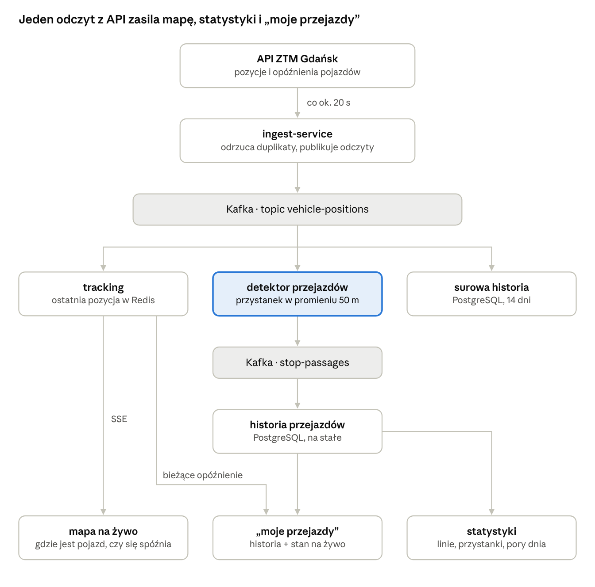

# Przebieg systemu: BusRadar Gdańsk

System zbiera strumień pozycji autobusów i tramwajów, zamienia go w historię przejazdów przez przystanki i odpowiada pasażerowi, jak punktualny jest jego codzienny przejazd, a do tego pokazuje mapę pojazdów na żywo.

przebieg danych · od API ZTM do trzech funkcji

Odczyt trafia do Kafki raz i rozgałęzia się do trzech konsumentów; z historią przejazdów wyprodukowaną przez detektor pracują statystyki i „moje przejazdy”.

## Big picture

Dane przechodzą przez system w czterech krokach: od pobrania z API ZTM do odpowiedzi dla pasażera.

1.  **Pobranie.** Co ok. 20 s ingest-service pobiera z API ZTM pozycje i opóźnienia wszystkich autobusów i tramwajów, odrzuca duplikaty i wysyła każdy odczyt do topicu Kafki `vehicle-positions`.

2.  **Rozgałęzienie w Kafce.** Ten sam odczyt czytają niezależnie trzy konsumenty:

    - **tracking** aktualizuje ostatnią pozycję pojazdu w Redisie i wypycha ją przez SSE na mapę,

    - **detektor przejazdów** wykrywa przejazd pojazdu przez przystanek i publikuje go do topicu `stop-passages`,

    - **zapis surowej historii** trafia do PostgreSQL na 14 dni, na potrzeby trybu odtwarzania i debugowania.

3.  **Gromadzenie.** Przejazdy przez przystanki trafiają na stałe do PostgreSQL. Ta historia jest głównym zasobem projektu: bez kilku tygodni danych nie ma statystyk, dlatego system musi działać na serwerze i zbierać dane 24/7 od 23.11.2026.

4.  **Wykorzystanie.** Z bieżącego stanu i z historii korzystają trzy funkcje:

    - **mapa:** gdzie jest teraz każdy pojazd i czy jest spóźniony,

    - **statystyki:** które linie i przystanki spóźniają się najczęściej i o jakich porach,

    - **„moje przejazdy”:** odpowiedź dla konkretnego pasażera o jego codziennym przejeździe.

## Wykrywanie przejazdów przez przystanki

To jest serce projektu: zamienia surowe pozycje pojazdów w historię, z której liczy się wszystko inne.

API mówi tylko, że „tramwaj 8 jest w punkcie (54.35, 18.64) i ma +300 s opóźnienia”. Nie mówi, przy którym przystanku jest. Żeby powiedzieć „linia 8 na Bramie Wyżynnej spóźnia się zwykle o 3 minuty”, system musi zamienić surowe pozycje w zdarzenia typu:

> linia 8 minęła przystanek Brama Wyżynna o 07:45 z opóźnieniem +5 min

Robi to detektor przejazdów, część tracking-service (obszar: Strumień zdarzeń i czas rzeczywisty). Czyta strumień `vehicle-positions`, sprawdza, czy pojazd jest w promieniu ok. 50 m od przystanku (współrzędne z listy przystanków GTFS), i publikuje zdarzenie do topicu `stop-passages`.

**Wszystkie statystyki i „moje przejazdy” liczą się z przejazdów przez przystanki, nie z surowych pozycji.**

## „Moje przejazdy”

Pasażer zapisuje swój codzienny przejazd, np. „122, Brama Wyżynna, dni robocze, 7:30”, a aplikacja łączy dla niego dwa źródła informacji: historię i stan na żywo.

**Historia.** System liczy, w ilu procentach dotychczasowych przejazdów linii 122 przez Bramę Wyżynną w dni robocze między 7:15 a 7:45 opóźnienie przekroczyło 3 minuty. Wynik brzmi np. „w 35% przypadków ten kurs się spóźnia”. To częstość z zebranych danych, a nie przewidywanie, i jedno zapytanie SQL na tabeli przejazdów.

**Stan na żywo.** Gdy pojazd jest już na trasie, tracking zna jego bieżące opóźnienie.

Wartość informacji zależy od tego, kiedy pasażer sprawdza:

| Kiedy sprawdza          | Co system wie                                                                         | Przykładowa odpowiedź                       |
|-------------------------|---------------------------------------------------------------------------------------|---------------------------------------------|
| godzinę przed wyjściem  | autobus często jeszcze nie wyjechał na trasę, więc jedynym źródłem jest historia      | „zwykle +2–5 min, 35% szans na ponad 3 min” |
| 15 minut przed wyjściem | pojazd już jedzie i ma bieżące opóźnienie z trackingu, dużo pewniejsze niż statystyka | „dziś +7 min, gorzej niż zwykle”            |

Połączenie obu źródeł odróżnia projekt od Jakdojade: pasażer widzi nie tylko dzisiejsze opóźnienie, ale też to, czy jest ono normą.

## Elementy, które nie są funkcjami, ale są częścią projektu

Użytkownik ich nie zobaczy, ale bez nich system nie działałby niezawodnie albo nie dałoby się go pokazać.

- **Odporność:** obsługa duplikatów, odczytów przychodzących nie po kolei, awarii API i restartu serwisu bez utraty danych. Na tym polega inżynierska wartość Kafki w tym projekcie.

- **Tryb odtwarzania:** nagrany dzień puszczony jeszcze raz przez Kafkę, do testów i do demo bez internetu.

- **Logowanie przez Keycloak:** potrzebne do zapisywania „moich przejazdów”.
